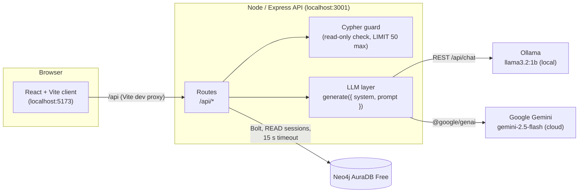
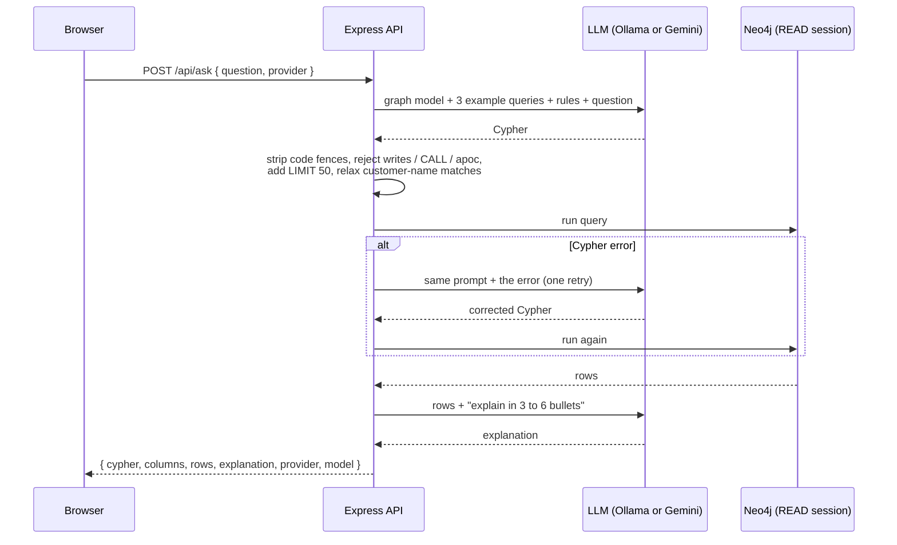

# Graph Insights

A small full-stack app that queries an e-commerce graph in **Neo4j AuraDB Free** and uses an LLM to explain the results in plain English. The LLM can be switched between a local model (**Ollama**, `llama3.2:1b`) and **Google Gemini** (free API key).

- Run 8 ready-made graph queries (order history, best sellers, recommendations, fraud rings and more).
- Ask an LLM to explain any result in 3–6 bullet points.
- Ask your own question in English: the LLM writes the Cypher, the server checks it is read-only, runs it and explains the answer.
- See the fraud rings as a network graph.

## Architecture



The browser only ever calls `/api`. All credentials stay in `server/.env`, and only the server talks to Neo4j, Ollama and Gemini.

How "Ask a question" works:



## Prerequisites

- **Node.js 20 or newer** (`node --version`)
- **A Neo4j AuraDB Free instance**, running, with the graph loaded (step 1 below). Free instances pause after a few days without use; resume it from the Aura console.
- **Ollama** installed: <https://ollama.com/download>
- **A Gemini API key** (free) from Google AI Studio: <https://aistudio.google.com/apikey>. This is optional if you only use Ollama.

## Setup

### 1. Load the graph into Aura (once)

1. Open your instance in the [Aura console](https://console.neo4j.io) and open the **Query** tool.
2. Open [ecommerce_load.cypher](ecommerce_load.cypher). In STEP 0, point `base` at the CSV files in this repo:
   ```
   :param base => 'https://raw.githubusercontent.com/SanjayaJena1207/graphdemo/main/';
   ```
3. Run the file. It creates constraints, then loads customers, orders, products, categories, addresses, devices and reviews from the CSVs.
4. To check it worked, run the queries in [ecommerce_queries.cypher](ecommerce_queries.cypher). For example, H3 should return 2 fraud rings, and the first has `riskScore = 100`.

### 2. Get the local model

```
ollama pull llama3.2:1b
ollama serve
```

On Windows and macOS the Ollama app usually runs the server for you; `ollama serve` is only needed if it isn't running already.

### 3. Fill in `server/.env`

Copy the example and fill in your values:

```
cp server/.env.example server/.env
```

| Variable | What to put |
| --- | --- |
| `NEO4J_URI` | Connection URI from the Aura console, e.g. `neo4j+s://xxxxxxxx.databases.neo4j.io` |
| `NEO4J_USERNAME` | Usually `neo4j` |
| `NEO4J_PASSWORD` | The password Aura gave you when you created the instance |
| `NEO4J_DATABASE` | Database name. Aura Free uses the instance ID or `neo4j`; check the console |
| `LLM_PROVIDER` | `ollama` or `gemini`, the default in the UI |
| `OLLAMA_URL` | `http://localhost:11434` |
| `OLLAMA_MODEL` | `llama3.2:1b` |
| `GEMINI_API_KEY` | Your key from Google AI Studio (leave empty to use Ollama only) |
| `GEMINI_MODEL` | `gemini-2.5-flash` (or `gemini-2.5-flash-lite`, see [Limits](#limits-and-gotchas)) |
| `PORT` | API port, `3001` |

`server/.env` is in `.gitignore`. Never commit it.

### 4. Install and run

From the repo root:

```
npm install
npm run dev
```

`npm run dev` starts both apps with `concurrently`:

- API on <http://localhost:3001>
- Client on <http://localhost:5173>: **open this one**

### 5. Check everything is connected

- In the app header, Neo4j should say **connected**, and the Ollama and Gemini buttons should each show a green dot.
- Or from a terminal:
  ```
  curl http://localhost:3001/api/health
  npm run test:queries
  ```
  `test:queries` runs all 8 catalog queries against Aura and checks the known answers (S1 for C001 → 3 rows; H3 → 2 rings, first riskScore 100).

## Using the app

- **Header:** pick the LLM (Ollama or Gemini). The dot shows whether it is reachable.
- **Query catalog:** each card is one of the 8 queries. S1 and H1 have a customer dropdown. **Run** shows the rows; **Run + Explain** also asks the LLM to explain them.
- **Ask a question:** type a question in English, e.g. *"Which customers bought both a phone and headphones?"*. You'll see the Cypher the LLM wrote, the rows and an explanation. If the query is rejected or fails, you'll see why.
- **Results:** explanation at the top, a table you can sort by clicking column headers, and a collapsible **Cypher** box with the exact query that ran. For H3, the **Network view** tab draws the fraud rings (red = high-risk ring).

## Scripts

Run from the repo root:

| Command | What it does |
| --- | --- |
| `npm run dev` | Start API and client together |
| `npm run typecheck` | TypeScript check for server and client |
| `npm run build` | Production build of the client |
| `npm run test:queries` | Run every catalog query against Aura and print row counts |

## Project layout

```
server/
  .env.example         settings template (copy to .env)
  src/
    index.ts           startup: Neo4j check, Ollama warm-up, graceful shutdown
    app.ts             Express routes and JSON error handling
    config.ts          loads and validates server/.env (zod)
    neo4j.ts           single driver, read-only runner, Neo4j → JSON conversion
    queries.ts         the 8 catalog queries (from ecommerce_queries.cypher)
    explain.ts         prompt for "explain these rows"
    ask.ts             text-to-Cypher: prompt, retry once, explain
    cypherGuard.ts     read-only check, LIMIT, customer-name relaxing
    rings.ts           nodes and links for the fraud-ring network view
    health.ts          Neo4j / Ollama / Gemini status
    llm/               one interface, ollama.ts + gemini.ts, provider factory
  scripts/run-all.ts   npm run test:queries
client/
  vite.config.ts       dev proxy: /api → localhost:3001
  src/
    App.tsx            page state and API calls
    api.ts             types and fetch helpers
    components/        Header, QueryCatalog, AskBox, ResultsPanel, ResultsTable, RingGraph
ecommerce_load.cypher     loads the CSVs into Aura
ecommerce_queries.cypher  the 8 tested queries
*.csv                     the dataset (25 customers, 67 orders, 36 products, ...)
```

## API

| Method and path | Body | Returns |
| --- | --- | --- |
| `GET /api/health` | | Neo4j status, active LLM provider, whether each provider is reachable |
| `GET /api/queries` | | The catalog: id, title, description, params, Cypher |
| `GET /api/customers` | | `[{ id, name }]` for the dropdown |
| `POST /api/queries/:id/run` | `{ params }` | `{ columns, rows, durationMs }` |
| `POST /api/explain` | `{ queryId, params, provider? }` | Rows plus `{ explanation, provider, model, llmMs }` |
| `POST /api/ask` | `{ question, provider? }` | Rows, explanation and the generated `cypher` |
| `GET /api/rings/graph` | | Nodes and links for customers in fraud rings |

Errors are always JSON, `{ "error": "..." }`, never stack traces. A rejected `/api/ask` also returns the `cypher` that was rejected.

Example:

```
curl -X POST http://localhost:3001/api/explain -H "Content-Type: application/json" -d "{\"queryId\":\"H3\",\"provider\":\"gemini\"}"
```

## Safety: letting an LLM write Cypher

LLM-written Cypher goes through two independent checks:

1. **The Cypher guard** ([server/src/cypherGuard.ts](server/src/cypherGuard.ts)) rejects any query containing `CREATE`, `MERGE`, `DELETE`, `DETACH`, `SET`, `REMOVE`, `DROP`, `FOREACH`, `LOAD CSV`, any `CALL` (including `CALL {}` subqueries, which can't be told apart from writes without a real parser), `apoc.`, or more than one statement. It also forces `LIMIT 50` or less.
2. **Every query runs in a READ session.** Even if something slipped past the guard, Neo4j would refuse to write.

Other rules: values from the UI (like `customerId`) are always sent as query parameters, never pasted into the Cypher string, and every query has a 15-second timeout.

## Limits and gotchas

- **`llama3.2:1b` often writes wrong Cypher. This is expected.** A 1-billion-parameter model is too small for text-to-Cypher: it copies the examples from its prompt, invents properties, or chains several queries together. Gemini does much better. Comparing the two is part of the point; see below.
- **The first Ollama call is slow.** Loading the model can take over a minute on a laptop. The server warms the model up at startup and keeps it loaded for 30 minutes; after that, answers take a few seconds.
- **Gemini free-tier quotas are small.** When this was built, `gemini-2.5-flash` allowed **20 requests per day**, and each Ask uses 2 (write Cypher, then explain). When the daily quota runs out, the app says so. Switch to Ollama, or set `GEMINI_MODEL=gemini-2.5-flash-lite` (which has its own quota) and restart the server. Check current limits in Google AI Studio.
- **Partial customer names.** People type "Pooja", not "Pooja Hegde", but LLMs tend to write an exact match. The server rewrites exact customer-name matches into case-insensitive `CONTAINS`. It only does this for customer names: for products, "phone" would also match "Headphones".
- **Aura Free pauses** after a period of inactivity. If the header says Neo4j is offline, resume the instance in the Aura console.

## Troubleshooting

| Symptom | Fix |
| --- | --- |
| Server prints `Invalid server/.env` | A required setting is missing; the message lists which one. |
| `Could not connect to Neo4j` at startup | Check `NEO4J_URI`, username and password, and that the Aura instance is running (not paused). |
| `Ollama is not running...` | Run `ollama serve`, then `ollama pull llama3.2:1b`. |
| `Ollama took longer than 180 seconds` | The model was still loading. Try again. |
| `Gemini free-tier rate limit reached` | Per-minute limit: wait a minute. |
| `Gemini free-tier daily quota ... is used up` | Switch to Ollama or another `GEMINI_MODEL`, or wait for the reset. |
| `couldn't write a working query` | The LLM's Cypher failed twice. Rephrase the question or switch to Gemini. |
| Client shows "Cannot reach the API server" | `npm run dev` isn't running, or the API crashed; check the terminal. |

## What I learned: Ollama vs Gemini

Observed on 2026-10-21 with the same prompts and the same data, `llama3.2:1b` on a laptop against `gemini-2.5-flash` (Gemini free tier).

| Question | llama3.2:1b | gemini-2.5-flash |
| --- | --- | --- |
| **Explain H3 (fraud rings)** | Fluent but wrong. It invented per-member device counts, said the rings were "low to moderate risk", and in other runs said there were "no chargebacks" (there were 5). | Correct on every number: 5 members, 2 shared devices, 2 shared addresses, 8 orders worth 777,189, 5 chargebacks, signups 4 days apart, risk 100; the second ring at risk 15. |
| **"Which customers bought both a phone and headphones?"** | Searched device types for `'phone' AND 'headphones'` → 0 rows. Valid Cypher, wrong question. | Matched the `Mobiles` and `Audio` categories → 5 customers. Correct first time. |
| **"List out orders from customer Pooja"** | Pasted copies of the prompt's example queries together → syntax error, failed after the retry. | Valid Cypher but an exact name match (`{name: 'Pooja'}`) → 0 rows. Fixed on the server by relaxing customer-name matches → 3 orders. |

Takeaways:

- **Size matters more for writing Cypher than for summarising.** The 1B model could sometimes summarise a table, but couldn't reliably map a question onto the graph schema.
- **Small models copy examples.** Adding a worked example to the prompt made `llama3.2:1b` answer an unrelated question with that example's query. Rules plus a server-side fix were safer than more examples.
- **Wrong but confident is the dangerous failure.** A query that runs and returns 0 rows gets a confident "no customers did X" explanation. Showing the generated Cypher next to the answer is what lets a person catch it.
- **Speed is a trade-off.** Once loaded, Ollama answered in 2–5 s with no quota. Gemini took about 4–7 s, needed the network and ran out of free requests within a day of testing.
- **Guard in code, not in the prompt.** "Read-only" in the prompt is a request. The keyword guard plus READ sessions are what make it actually read-only.
